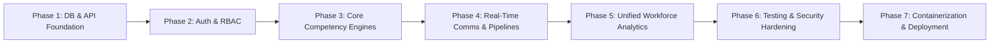

# StatSkillAI: Production Transition Master Plan

## Executive Overview
**StatSkillAI** is an AI-powered competency measurement, skill-gap diagnostic, and career development platform aligned with India's **National Education Policy (NEP) 2020** and **Mission Karmayogi**. It serves three primary user cohorts:
1. **Students & Young Graduates**: Measuring foundational statistical and computing capability, diagnosing deficiencies, and securing fellowships/jobs.
2. **Government Employees & Civil Servants**: Closing technical gaps in automated pipelines, survey auditing, and administrative data linkage.
3. **Private-Sector & Civic Tech Professionals**: Modernizing capabilities for enterprise analytics, public policy evaluation, and digital public goods.

Currently, the platform operates as a rich prototype using client-side `localStorage` state management and simulated seed datasets. This document outlines the complete extraction of current flows, an audit of logical gaps and bugs, questions requiring user alignment, and a phased execution roadmap to transform StatSkillAI into a production-grade, multi-tenant, cloud-deployed system.

---

## Part 1: Extraction of Current Seeded Flow & Data

### 1. Domain Entities & Schemas (`src/types/index.ts`)
The application defines 14 core TypeScript models:

| Entity | Primary Fields | Current Source / Storage | Description |
| :--- | :--- | :--- | :--- |
| **`User`** | `id`, `name`, `email`, `role`, `profileType`, `department`, `designation` | `SEED_USERS` in `seedData.ts` | Base user identity across three roles: `learner`, `mentor`, `admin`. |
| **`LearnerProfile`** | `userId`, `fullName`, `highestEducation`, `qualifications`, `skills`, `interests`, `previousTrainings`, `careerGoal`, `targetDomainScores`, `completeness` | `SEED_PROFILES` in `seedData.ts` | Detailed learner biographical, educational, and target competency profile. |
| **`AssessmentAttempt`** | `id`, `userId`, `domain`, `date`, `questions`, `userAnswers`, `score`, `earnedWeight`, `maxWeight`, `completed` | `SEED_INITIAL_ATTEMPTS` | Record of psychometric assessment attempt across 4 core domains. |
| **`GapAnalysis`** | `id`, `userId`, `timestamp`, `strengths`, `gaps`, `summary`, `priorityOrder`, `domainScores`, `targetScores`, `overallScore` | `SEED_INITIAL_GAPS` | AI-generated diagnostic report highlighting deficiencies by severity (`High`, `Medium`, `Low`). |
| **`Course`** | `id`, `title`, `domain`, `provider`, `source`, `duration`, `level`, `description`, `portalUrl`, `skillsCovered` | `SEED_COURSES` | Curated course catalog mapped to SWAYAM, NPTEL, iGOT Karmayogi, and NCS. |
| **`LearningPath`** | `id`, `userId`, `title`, `careerGoal`, `steps`, `progressPercent`, `isCompleted` | `SEED_INITIAL_LEARNING_PATH` | Sequenced competency progression modules with statuses (`Not started`, `In progress`, `Completed`). |
| **`Opportunity`** | `id`, `title`, `organisation`, `orgId`, `sector`, `location`, `type`, `requiredSkills`, `minDomainLevels`, `deadline`, `stipendOrSalary` | `SEED_OPPORTUNITIES` | Verified openings (Jobs, Internships, Fellowships, Training Programmes). |
| **`Application`** | `id`, `opportunityId`, `opportunityTitle`, `organisation`, `userId`, `userName`, `appliedAt`, `status`, `matchPercentage` | `localStorage` (`applications`) | Candidate submissions with statuses: `Submitted`, `Under review`, `Shortlisted`, `Closed`. |
| **`Mentor`** | `id`, `userId`, `name`, `title`, `organisation`, `field`, `experienceYears`, `languages`, `bio`, `isVerified`, `availability`, `rating` | `SEED_MENTORS` | Verified statistical experts and civil service domain mentors. |
| **`Mentorship`** | `id`, `mentorId`, `learnerId`, `goalMessage`, `status`, `meetingSchedule`, `feedbackNotes`, `recommendedSteps`, `rating` | `SEED_MENTORSHIPS` | Active mentorship relationship with statuses: `Pending`, `Accepted`, `Declined`, `Completed`. |
| **`DirectMessage`** | `id`, `mentorshipId`, `senderId`, `senderName`, `senderRole`, `text`, `timestamp` | `SEED_DIRECT_MESSAGES` | Asynchronous 1-on-1 messaging thread between mentor and mentee. |
| **`OrgEmployee`** | `id`, `name`, `email`, `department`, `designation`, `scores`, `participationStatus`, `trainingStatus`, `criticalGapsCount` | `generateSeedOrgEmployees()` | 65 simulated departmental employees for institutional workforce analytics. |
| **`QuizRecord`** | `id`, `userId`, `title`, `sourceType`, `difficulty`, `questions`, `userAnswers`, `score` | `localStorage` (`quizzes`) | Custom AI-generated document comprehension quiz records. |
| **`AppSettings`** | `language`, `highContrast`, `fontSize`, `activeUserId` | `localStorage` (`settings`) | Accessibility, locale (English/Hindi), and demo user switching context. |

---

### 2. User Workflows by Role

```mermaid
flowchart TD
    subgraph Learner Flow
        L1[Select Demo Learner] --> L2[Review Dashboard & Radar Chart]
        L2 --> L3[Edit Profile & Target Competencies]
        L3 --> L4[Take 5-Q Adaptive Assessment]
        L4 --> L5[Generate AI Skill-Gap Analysis]
        L5 --> L6[Synthesize Personalized Learning Path]
        L6 --> L7[Upload PDF / Generate Quiz Practice]
        L5 --> L8[Opportunity Matching & One-Click Apply]
        L5 --> L9[Request Verified Mentor & Direct Chat]
        L4 -. Context .-> L10[Floating AI Assistant Chat]
    end

    subgraph Mentor Flow
        M1[Select Mentor Demo Account] --> M2[Mentor Dashboard: Requests Roster]
        M2 --> M3[Accept or Decline Mentorship Requests]
        M3 --> M4[Inspect Mentee Radar, Scores & Gaps]
        M4 --> M5[Issue Written Directives & Recommendations]
        M5 --> M6[Direct Message Thread with Mentee]
    end

    subgraph Admin Flow
        A1[Select Admin Demo Account] --> A2[Workforce Competency Heatmap & KPIs]
        A2 --> A3[Generate AI Institutional Risk Insights]
        A1 --> A4[Manage Course & Opportunity Catalogs]
        A1 --> A5[Applicant Tracking & Status Pipeline]
        A1 --> A6[Verify / Revoke Mentor Credentials]
        A1 --> A7[System Accessibility & Data Reset]
    end
```

---

## Part 2: Logical Bugs, Gaps & Architectural Vulnerabilities

During thorough source-level inspection, the following critical issues were identified:

### 1. Security & Identity Flaws
* **No Real Authentication**: The login system (`LoginPage.tsx`) switches users by simply mutating `statskillai:settings.activeUserId` in `localStorage`. There are no passwords, password hashes, JWTs, or session cookies.
* **Trivial Privilege Escalation**: The client-side route guard (`ProtectedRoute` in `App.tsx`) checks `currentUser.role` directly from React Context. Any user can open the browser developer console, set `activeUserId` to `"user-admin"`, and gain full administrative access.
* **Zero Data Isolation**: Because all records reside in a single client's `localStorage`, user data is completely localized. Learner Aarav and Mentor Dr. Anita Rao cannot communicate from separate computers because their storage is not synchronized over a network.

### 2. Disconnected Workforce Analytics
* **Synthetic vs Real Data Disconnect**: In `AdminAnalyticsPage.tsx`, all charts, KPIs, and department heatmaps are powered by `generateSeedOrgEmployees()`, which generates 65 static fake employees. Registered platform users and learners who take real assessments are **never added** to this dataset. Workforce analytics is entirely decoupled from actual user activity.

### 3. State Incoherence & Broken Feedback Loops
* **Stale Gap Analysis**: When a learner completes an assessment on `AdaptiveAssessmentPage.tsx`, their domain score is updated in `storageService`. However, their `GapAnalysis` is **not** automatically updated. The learner must navigate to `/gap-analysis` and manually click "Recalculate Gaps". Otherwise, the dashboard displays conflicting data (new assessment score vs old gap report).
* **Missing Skill-Score Feedback Loop**: When a learner completes courses or practice steps in `LearningPathPage.tsx`, their domain scores do not increment, nor does the system prompt for a verification re-assessment.
* **Fragile Step Preservation**: When a mentor adds a recommended step on `MenteeDetailPage.tsx`, it appends directly to the mentee's current learning path. If the mentee subsequently regenerates their learning path on `LearningPathPage.tsx`, mentor steps risk being wiped out or duplicated.

### 4. Application Tracker Black Hole
* In `OpportunitiesPage.tsx`, learners apply for jobs/internships, creating an `Application` record. When an admin updates an applicant's status to `Under review` or `Shortlisted` in `AdminApplicantsPage.tsx`, the learner receives no notifications, banner alerts, or status tracking indicators on their dashboard.

### 5. Assessment Psychometric Gaps
* **Empty Historical Questions**: In `seedData.ts`, historical attempts in `SEED_INITIAL_ATTEMPTS` have `questions: []`. As a result, reviewing past assessment attempts cannot render the questions or answers that were evaluated.
* **Question Bank Exhaustion in Fallback Mode**: If Gemini AI is unavailable or unconfigured, `aiFallbacks.ts` provides only 3–4 static fallback questions per domain. After taking two assessments, questions repeat identically.

### 6. Document Parsing & Quiz Generator Limitations
* `QuizGeneratorPage.tsx` converts entire PDF files to raw base64 and posts them to `/api/gemini/generate`. Large files cause payload bloat and network timeouts. There is no server-side document parser (e.g. `pdf-parse`) to sanitize, chunk, and extract text.
* Quizzes created by learners are saved ephemerally in `quizzes` with no dedicated interface to review past quiz scores, explanations, or question-level mistakes.

---

## Part 3: Architecture Decisions & User Alignment (CONFIRMED)

The user has explicitly aligned and approved the architectural choices:

### 1. Database & Backend Architecture: **Option A (CONFIRMED)**
* **Technology**: **PostgreSQL + Prisma ORM**
* **Rationale**: Strong schema enforcement, relational integrity, type-safety, and seamless migration pipeline for psychometric assessment attempts, scores, and institutional heatmaps.

### 2. Authentication & User Onboarding: **Option A (CONFIRMED)**
* **Technology**: **Email & Password + JWT Sessions**
* **Rationale**: Industry-standard authentication using `bcryptjs` password hashing, signed JSON Web Tokens (JWT), HTTP-only secure cookie sessions, and server-side Role-Based Access Control (`learner`, `mentor`, `admin`).

### 3. Department & Organization Scope: **Option A (CONFIRMED)**
* **Technology**: **Pre-seeded Public & Institutional Entities**
* **Rationale**: Nodal government departments and premier institutes (MoSPI, NIC, ISI, NITI Aayog, RBI, Census, etc.) are pre-configured in the database. Users select their institutional affiliation during registration, enabling automatic workforce aggregation in Admin Analytics.

### 4. Real-Time Mentorship Communication: **Option A (CONFIRMED)**
* **Technology**: **WebSockets via Socket.io**
* **Rationale**: Real-time bidirectional event transport for 1-on-1 mentor-mentee messaging, instant read receipts, typing indicators, and immediate status change notifications for application updates.

### 5. Deployment Environment: **Option D (CONFIRMED - Zero-Cost Tier)**
* **Technology**: **Vercel (Frontend SPA) + Free Node/Express Backend (Render / Koyeb / Railway) + Free Cloud PostgreSQL (Neon / Supabase)**
* **Rationale**: Provides zero-cost production hosting while supporting long-running WebSockets (Socket.io) on the Express backend and high-performance CDN delivery for the React 19 frontend on Vercel.

---

## Part 4: Step-by-Step Transition & Implementation Roadmap

### Phase 1: Database Schema & Real Backend Architecture
* **Objective**: Eliminate `localStorage` dependence and establish a persistent relational database.
* **Key Tasks**:
  1. Initialize database schema (Prisma/PostgreSQL) defining tables: `User`, `LearnerProfile`, `DomainScore`, `AssessmentAttempt`, `QuestionRecord`, `GapAnalysis`, `SkillGapItem`, `Course`, `LearningPath`, `LearningStep`, `Opportunity`, `Application`, `MentorProfile`, `Mentorship`, `DirectMessage`, `QuizRecord`, `Department`, and `AuditLog`.
  2. Implement an automated seed script (`prisma/seed.ts`) that loads default courses, opportunities, organizations, and initial question banks from `seedData.ts` into PostgreSQL.
  3. Refactor `server.ts` into a modular Express REST API structure:
     - `/api/auth` (Registration, login, refresh, logout)
     - `/api/profile` (Learner profile CRUD and target scores)
     - `/api/assessments` (Adaptive test generation, submission, attempt history)
     - `/api/gaps` (Gap diagnostic reports)
     - `/api/paths` (Learning path steps and status updates)
     - `/api/opportunities` & `/api/applications` (Catalog and applicant tracking)
     - `/api/mentorship` (Directory, requests, directives, direct messages)
     - `/api/analytics` (Institutional heatmaps and KPI aggregation)
     - `/api/quizzes` (Document comprehension generation and history)

### Phase 2: Production Authentication & Role-Based Access Control (RBAC)
* **Objective**: Secure the application with real identity verification and data isolation.
* **Key Tasks**:
  1. Implement password hashing using `bcryptjs` and session tokens using `jsonwebtoken` (JWT).
  2. Implement authentication middleware (`authenticateToken`, `requireRole('admin')`, `requireRole('mentor')`).
  3. Replace the prototype demo switcher in `LoginPage.tsx` with a secure sign-in and sign-up portal supporting `ProfileType` selection (`Student`, `Government Employee`, `Private-Sector Professional`).
  4. Ensure all database queries enforce row-level tenant security (learners can only view/mutate their own attempts, paths, and messages; mentors can only access assigned mentees).

### Phase 3: Core Competency Engines & Closed-Loop Workflow Coupling
* **Objective**: Fix state disconnects between tests, gaps, and learning paths.
* **Key Tasks**:
  1. **Adaptive Testing Engine**: Move the computerized adaptive algorithm server-side. Track question history, calculate difficulty transitions (Easy/Medium/Hard) using Item Response Theory (IRT) or weighted scoring, and store complete question text in `AssessmentAttempt`.
  2. **Automated Diagnostic Pipeline**: When an assessment is finalized, automatically trigger a recalculation of `GapAnalysis` in the background and update radar benchmarks without requiring manual button clicks.
  3. **Learning Path Progression**: When a learner marks learning steps as `Completed`, award domain competency points and trigger an optional verification quiz. Ensure mentor-recommended steps are preserved across AI regenerations.

### Phase 4: Real-Time Communication & Document Ingestion
* **Objective**: Enable live messaging, notifications, and robust PDF document handling.
* **Key Tasks**:
  1. Integrate **Socket.io** on Express to provide real-time mentor-mentee messaging with unread badges, delivery receipts, and live status.
  2. Implement an application status notification pipeline: when an admin updates an application to `Under review` or `Shortlisted`, dispatch a real-time event and persist a notification badge to the learner's dashboard.
  3. Add server-side PDF parsing (`pdf-parse`) and text chunking to sanitize and extract text from uploaded documents before sending prompts to Gemini AI, preventing payload overflow.
  4. Add a "Quiz History" view where learners can review past generated quizzes, answer keys, and explanations.

### Phase 5: Unified Workforce Analytics
* **Objective**: Connect actual platform users directly into institutional analytics.
* **Key Tasks**:
  1. Refactor `AdminAnalyticsPage.tsx` to compute KPIs and the Department Competency Heatmap directly from real registered `User` and `AssessmentAttempt` database records.
  2. Provide department filtering based on real organizational affiliations (e.g. MoSPI, NIC, NITI Aayog).
  3. Cache Gemini AI workforce insights to prevent quota exhaustion and reduce analytics page latency.

### Phase 6: Reliability, Accessibility & Security Hardening
* **Objective**: Prepare the application for audit compliance and high load.
* **Key Tasks**:
  1. Verify **WCAG 2.1 AA** compliance across all pages (ARIA attributes, keyboard navigation, contrast modes, and bilingual English/Hindi strings).
  2. Secure Express with `helmet`, strict `cors` origins, input validation schemas (`zod`), and rate-limiting middleware (`express-rate-limit`).
  3. Write end-to-end integration tests covering the complete Learner, Mentor, and Admin workflows.

### Phase 7: Containerization & Production Deployment
* **Objective**: Deploy StatSkillAI to a resilient cloud production environment.
* **Key Tasks**:
  1. Create a production-ready, multi-stage `Dockerfile` optimizing build size.
  2. Author a `docker-compose.yml` defining the Web Service, PostgreSQL database, and Redis cache.
  3. Set up automated environment variable injection (`GEMINI_API_KEY`, `DATABASE_URL`, `JWT_SECRET`, `PORT`).
  4. Execute production build (`npm run build`), verify static asset caching, and deploy to the target hosting environment.
  5. Conduct smoke testing and hand off administrative credentials.
